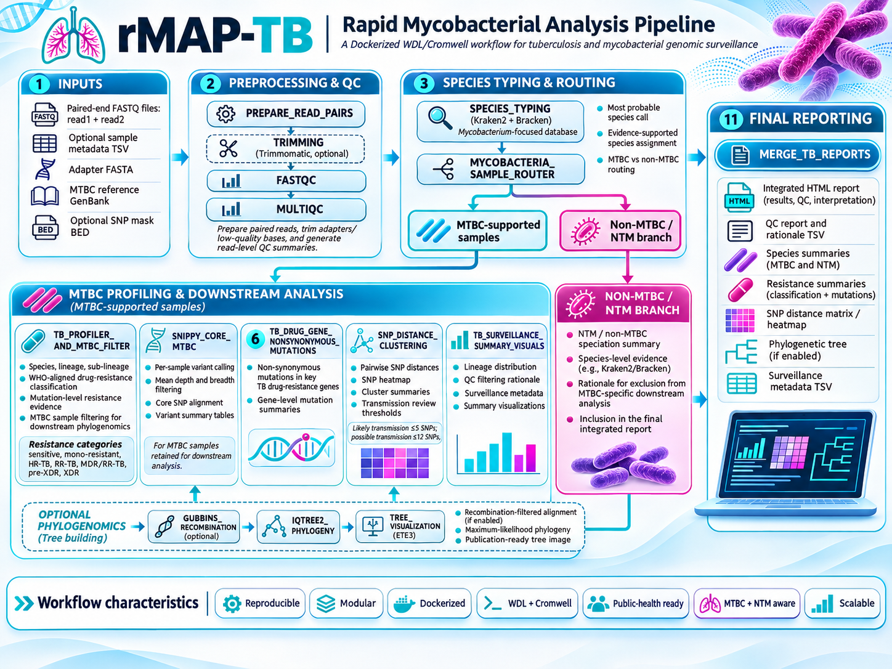
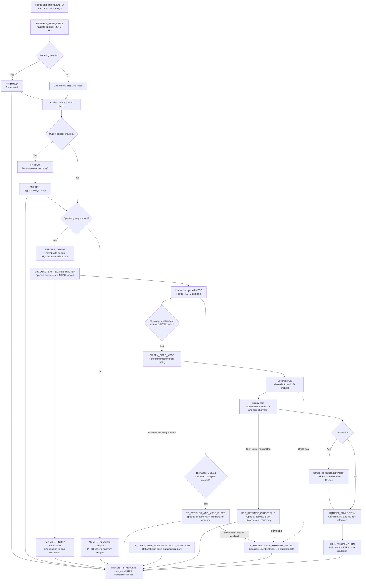

rMAP-TB: Rapid Mycobacterial Analysis Pipeline for Tuberculosis & Mycobacterial Genomic Surveillance
---
rMAP-TB is a modular, reproducible, Dockerized WDL/Cromwell bioinformatics workflow for public-health-oriented genomic analysis of Mycobacterium tuberculosis complex (MTBC) and non-MTBC mycobacteria. It supports paired-end Illumina FASTQ inputs and integrates read preprocessing, sequence quality control, species identification, MTBC/NTM sample routing, tuberculosis drug-resistance prediction, species and lineage profiling, MTBC-only sample filtering, core-SNP phylogenomics, SNP distance analysis, optional phylogenetic reconstruction, and interactive genomic surveillance reporting.

The workflow first performs read trimming, sequence quality control, and Kraken2/Bracken-based Mycobacterium species identification. Species typing is used to route samples before TB-Profiler execution: MTBC-supported samples proceed to TB-Profiler for drug-resistance prediction, species identification, and lineage profiling, while non-MTBC mycobacteria are summarized separately through a dedicated nontuberculous mycobacteria (NTM) speciation branch. This approach enables the workflow to report the most probable NTM species without subjecting non-MTBC samples to MTBC-specific resistance and lineage analyses.

For MTBC-supported samples, rMAP-TB integrates reference-based read alignment, variant calling, core-genome SNP identification, and SNP distance analysis to support genomic relatedness assessments and molecular epidemiological investigations. Optional phylogenomic reconstruction enables the characterization of evolutionary relationships among isolates, supporting investigations of potential transmission clusters and population structure.

The pipeline combines antimicrobial resistance prediction, taxonomic identification, phylogenomic analysis, and genomic surveillance reporting within a standardized, portable, and reproducible computational framework. Containerized execution through Docker and workflow orchestration using WDL/Cromwell facilitate consistent analyses across compatible local, institutional, and cloud computing environments.

## Visual Overview of the rMAP-TB Workflow

The rMAP-TB pipeline integrates sequencing quality control, Mycobacterium species identification, MTBC/NTM sample routing, tuberculosis drug-resistance prediction, core-SNP analysis, phylogenomic reconstruction, and genomic surveillance reporting within a reproducible WDL/Cromwell framework.



*Figure 1. Overview of the rMAP-TB workflow, showing paired-end Illumina sequencing inputs, read preprocessing and quality control, Kraken2/Bracken-based species identification, MTBC/NTM sample routing, TB-Profiler-based drug-resistance and lineage profiling for MTBC-supported samples, independent NTM species reporting, core-SNP analysis, SNP distance estimation, optional phylogenomic reconstruction, and integrated interactive genomic surveillance reporting.*

## Detailed workflow logic & sample routing

rMAP-TB v19 implements a conditional, Dockerized WDL/Cromwell workflow. It separates species identification and sample routing from MTBC-specific resistance analysis and phylogenomics. Non-MTBC samples remain represented in the final surveillance report without undergoing inappropriate MTBC-specific analyses.



### Species identification and routing decisions

The `SPECIES_TYPING` task uses Kraken2 and a custom *Mycobacterium*-focused reference database. Although the container name includes Bracken, **Bracken is not executed in v19**.

The routing algorithm considers the top species-level assignment, MTBC-complex read support, and confidence evidence:

1. **Recognized MTBC species:** Samples with a recognized MTBC top species call are retained for MTBC-specific analyses.
2. **MTBC-complex majority:** Samples with at least 50% MTBC-complex support and at least 1,000 supporting reads are retained, even if another species is the highest individual species-level assignment.
3. **Clear non-MTBC species:** A high-confidence non-MTBC *Mycobacterium* call is excluded from MTBC-specific analyses unless the MTBC-majority override applies.
4. **Unresolved species with MTBC evidence:** MTBC support of at least 10% and 1,000 reads can rescue an otherwise unresolved species-level call for MTBC routing.
5. **No sufficient MTBC evidence:** Samples are excluded from MTBC-specific downstream analysis and retained in the routing and species reports.

The default minimum species-call percentage is 5%. Routing decisions and supporting evidence are recorded in `mycobacteria_routing_summary.tsv`.

### MTBC-specific analysis

For Kraken2-supported MTBC samples, **TB-Profiler** performs tuberculosis drug-resistance prediction, lineage identification, species profiling, and mutation-evidence reporting.

When phylogenomic analysis is enabled and at least three MTBC read pairs are available, `SNIPPY_CORE_MTBC` performs reference-based variant calling. Coverage filtering is then applied before samples enter the core alignment.

Default coverage requirements:

- Minimum mean sequencing depth: **15×**
- Minimum breadth covered at 10×: **90%**
- Optional repetitive/PE-PPE-region masking using `snp_mask_bed`

The subsequent analyses branch from the Snippy results:

- **Drug-gene mutation analysis:** Optional extraction of nonsynonymous variants in selected tuberculosis drug-resistance-associated genes.
- **Pairwise SNP distances:** Comparison using the Snippy `core.full.aln` alignment before any optional Gubbins filtering.
- **SNP clustering:** Interpretation using default thresholds of 5 SNPs for likely genomic linkage and 12 SNPs for possible genomic linkage, subject to quality and eligibility gates.
- **Phylogenetic reconstruction:** Optional Gubbins recombination filtering followed by IQ-TREE2 maximum-likelihood inference.

The default minimum number of comparable alignment sites for clustering is 2,205,000. Samples flagged by TB-Profiler as possible mixed infections are excluded from transmission clustering by default.

**Important:** SNP-distance thresholds indicate genomic relatedness; they do not independently establish direct transmission.

### Optional recombination filtering and phylogeny

Gubbins is **disabled by default** (`use_gubbins = false`), reflecting the highly clonal nature of MTBC. When enabled, its filtered alignment is passed to IQ-TREE2. If Gubbins fails internally, the task passes the original core alignment forward.

IQ-TREE2 uses the default `GTR+G` model and 1,000 bootstrap replicates. Before inference, sequences with at least 50% missing or ambiguous alignment content are excluded from the tree only. At least three non-reference samples must remain for phylogenetic inference.

The `TREE_VISUALIZATION` task generates an SVG phylogeny directly from the Newick tree and attempts ETE3-based raster rendering, with rendering-status information retained for reporting.

### Integrated genomic surveillance outputs

`TB_SURVEILLANCE_SUMMARY_VISUALS` generates surveillance information when TB-Profiler results are available, including lineage distributions, SNP-distance heatmaps where available, coverage summaries, QC-filtering rationale, and associated metadata.

Finally, `MERGE_TB_REPORTS` consolidates available outputs into an integrated, interactive HTML report, including:

- Sequence QC and trimming summaries
- Species identification and MTBC/NTM routing
- TB-Profiler resistance, lineage, and mutation evidence
- Nonsynonymous drug-gene mutations, when enabled
- Pairwise SNP distances and cluster interpretations
- Lineage distribution and SNP-distance visualizations
- Core-SNP phylogenetic trees, where generated
- Sample inclusion/exclusion rationale and pipeline provenance

**NTM-only datasets:** If no MTBC-supported samples are detected, TB-Profiler and MTBC-specific phylogenomic tasks are skipped. The final report retains the available species-identification, NTM-routing, QC, and provenance information.

All optional analyses depend on their WDL execution conditions and available upstream outputs.

## Repository Structure

The rMAP-TB repository is organized into modular workflow
components, reference resources, reproducible input
configurations, supporting scripts, and documentation.

```text
rMAP-TB/
├── README.md
├── LICENSE
├── .dockstore.yml
├── .gitignore
├── rMAP_TB.wdl
│
├── examples/
│   ├── inputs.example.json
│   └── inputs.terra.example.json
│
├── scripts/
│   └── build_snp_mask.py
│
├── resources/
│   ├── adapters/
│   │   └── adapters.fa
│   ├── reference/
│   │   └── H37Rv_NC_000962.3.gb
│   └── mask/
│       ├── H37Rv_NC_000962.3_PE_PPE_repetitive.bed
│       └── README.md
│
├── tests/
│
└── docs/
    ├── index.html
    ├── DEPLOYMENT.md
    ├── reports/
    │   ├── small_dataset/
    │   ├── medium_dataset/
    │   └── large_dataset/
    └── assets/
        ├── workflow/
        │   └── rMAP-TB-workflow.png
        ├── images/
        └── css/
```

### Directory Descriptions

| Directory / File | Description |
|---|---|
| `rMAP_TB.wdl` | Main WDL workflow defining the pipeline tasks and dependencies |
| `examples/` | Example input JSON files for local Cromwell and Terra execution |
| `scripts/` | Supporting scripts for workflow preparation and analysis |
| `resources/adapters/` | Adapter sequences used during read trimming |
| `resources/reference/` | MTBC reference genome in GenBank format |
| `resources/mask/` | BED files defining genomic regions excluded from selected SNP analyses |
| `tests/` | Automated workflow and supporting-script tests |
| `docs/` | Documentation and GitHub Pages website |
| `docs/assets/workflow/` | Workflow infographics and scientific diagrams |
| `docs/reports/` | Example analysis reports and benchmarking outputs |

## Requirements

| Requirement | Purpose |
|---|---|
| Java | Required to execute the Cromwell workflow engine |
| Cromwell | WDL workflow execution locally or on supported cloud backends |
| Docker | Runs containerized bioinformatics tools |
| Paired-end Illumina FASTQ files | Input sequencing reads |
| Adapter FASTA | Adapter trimming with Trimmomatic |
| MTBC GenBank reference | Reference-guided variant calling and core-SNP alignment |
| Kraken2/Bracken database | Mycobacterial species identification |
| TB-Profiler database | TB lineage identification and drug-resistance prediction |
| Sufficient computing resources | Variant calling, phylogenomics, SNP analysis, and report generation |


## Main Workflow Inputs

rMAP-TB accepts paired-end Illumina sequencing reads, an MTBC reference genome, an adapter reference file, and configurable parameters controlling the execution of individual analytical modules. Input parameters are defined in the `rMAP_TB` workflow and can be supplied through a Cromwell JSON file or the Terra workflow input interface.

### Required inputs

| Input parameter | WDL type | Description |
|---|---|---|
| `read1` | `Array[File]+` | One or more forward-read (R1) FASTQ files |
| `read2` | `Array[File]+` | Matching reverse-read (R2) FASTQ files |
| `adapters` | `File` | Adapter sequences in FASTA format for Trimmomatic |
| `mtbc_reference_genbank` | `File` | MTBC reference genome in GenBank format for Snippy variant calling |

The `read1` and `read2` arrays must contain equal numbers of files, with matching samples in corresponding array positions.

The recommended MTBC reference is *Mycobacterium tuberculosis* H37Rv (NC_000962.3). The same reference should be used consistently across samples in a comparative analysis.

### Optional sample metadata

The optional `sample_metadata_tsv` input accepts a tab-delimited file containing sample identifiers and associated epidemiological metadata.

Example:

```tsv
sample	country	collection_year	collection_site	sample_source
SAMPLE001	Uganda	2026	Kampala	Sputum
SAMPLE002	Kenya	2026	Nairobi	Sputum
SAMPLE003	Tanzania	2026	Dar es Salaam	Sputum
```

Supported sample identifier columns include `sample`, `sample_id`, `isolate`, `isolate_id`, `accession`, `run_accession`, and `sra_accession`.

Additional metadata columns are retained in the surveillance metadata output with a `user_` prefix. Sample identifiers must match those generated during FASTQ processing.

### Workflow execution controls

| Parameter | Default | Description |
|---|---|---|
| `do_trimming` | `true` | Enable Trimmomatic preprocessing |
| `do_quality_control` | `true` | Enable FastQC and MultiQC |
| `do_species_typing` | `true` | Enable Kraken2 species identification and sample routing |
| `do_tb_profiler` | `true` | Enable TB-Profiler for MTBC-supported samples |
| `do_phylogeny` | `true` | Enable MTBC core-SNP and phylogenomic analysis |
| `use_gubbins` | `false` | Enable optional recombination filtering |
| `report_nonsynonymous_drug_gene_mutations` | `true` | Generate nonsynonymous drug-gene mutation summaries |
| `report_snp_distance_clusters` | `true` | Enable pairwise SNP distances and cluster interpretation |
| `generate_surveillance_summary_visuals` | `true` | Generate lineage, SNP and surveillance visualizations |
| `midpoint_root_tree` | `true` | Apply midpoint rooting to tree visualization |

Species typing uses **Kraken2** with a custom Mycobacterium database. Bracken is not executed in the v19 WDL, despite being referenced in the species-typing Docker image name.

### Variant filtering and genomic epidemiology parameters

| Parameter | Default | Description |
|---|---|---|
| `min_species_call_percent` | `5.0` | Minimum percentage for a confident species assignment |
| `mtbc_node_override_percent` | `50.0` | MTBC-complex read-support override threshold |
| `min_mtbc_samples_for_tree` | `3` | Minimum MTBC read pairs for initiating the phylogenomics branch |
| `min_mean_depth` | `15` | Minimum mean sequencing depth (15×) |
| `min_breadth_10x` | `0.90` | Minimum genome breadth covered at 10× |
| `min_mapping_quality` | `20` | Minimum mapping-quality parameter supplied to Snippy |
| `min_comparable_sites` | `2205000` | Minimum jointly unambiguous alignment sites for cluster interpretation |
| `likely_transmission_snp_threshold` | `5` | Default SNP threshold for likely genomic linkage |
| `possible_transmission_snp_threshold` | `12` | Default SNP threshold for possible genomic linkage |
| `exclude_mixed_infection_from_clustering` | `true` | Exclude TB-Profiler-flagged mixed infections from clustering |
| `max_heterozygous_sites_for_clustering` | `0` | Optional additional ambiguity gate; zero disables it |
| `iqtree2_model` | `GTR+G` | Maximum-likelihood substitution model |
| `iqtree2_bootstraps` | `1000` | Number of phylogenetic bootstrap replicates |
| `max_cpus` | `16` | Configurable maximum CPU allocation |
| `max_memory_gb` | `64` | Memory allocation for configurable high-resource tasks |

The optional `snp_mask_bed` input specifies repetitive, PE/PPE, or low-confidence regions to exclude during variant calling. A validated masking file is strongly recommended when interpreting MTBC SNP distances using published epidemiological thresholds.

All SNP-linkage thresholds are configurable and should be interpreted alongside epidemiological evidence, sequencing quality, genome comparability, and sampling context.

---

## Installation & Execution

### System requirements

rMAP-TB is implemented in Workflow Description Language (WDL) and is designed for execution using Cromwell with Docker-compatible task execution.

The following components are required:

| Component | Purpose |
|---|---|
| Java | Runs the Cromwell workflow engine |
| Cromwell | Executes and manages the WDL workflow |
| Docker | Provides containerized bioinformatics tools |
| Git | Retrieves and manages the repository |
| Illumina FASTQ data | Supplies paired-end sequencing reads |
| Adapter FASTA | Supports Trimmomatic preprocessing |
| MTBC GenBank reference | Supports reference-guided variant calling |
| Adequate computing resources | Supports read processing, alignment, phylogeny, and reporting |

The workflow can be deployed on compatible local computing environments, institutional high-performance computing systems, or supported cloud platforms such as Terra.

Individual tasks request substantial memory and disk capacity, particularly during TB-Profiler, Snippy, Gubbins, and IQ-TREE2 execution. Computational requirements increase with dataset size.

### Clone the repository

```bash
git clone https://github.com/gmboowa/rMAP-TB.git
cd rMAP-TB
```

Confirm that the workflow file and supporting resources are available:

```bash
ls -lh rMAP_TB.wdl
ls -lh resources/
```

Ensure that `rMAP_TB.wdl` contains the intended v19 workflow before execution.

### Install the workflow engine

Install a Java version supported by your chosen Cromwell release.

Download Cromwell from the official Broad Institute repository:

https://github.com/broadinstitute/cromwell/releases

Save the downloaded JAR as `cromwell.jar`, or use its original filename in subsequent commands.

Confirm Java availability:

```bash
java -version
```

Confirm Docker availability:

```bash
docker --version
docker info
```

Docker must be running, and the selected Cromwell backend must support Dockerized task execution.

### Prepare the input JSON

Create an input configuration file named `inputs.json` in the repository root.

Example for three paired-end samples:

```json
{
  "rMAP_TB.read1": [
    "/absolute/path/SAMPLE001_R1.fastq.gz",
    "/absolute/path/SAMPLE002_R1.fastq.gz",
    "/absolute/path/SAMPLE003_R1.fastq.gz"
  ],
  "rMAP_TB.read2": [
    "/absolute/path/SAMPLE001_R2.fastq.gz",
    "/absolute/path/SAMPLE002_R2.fastq.gz",
    "/absolute/path/SAMPLE003_R2.fastq.gz"
  ],
  "rMAP_TB.adapters": "/absolute/path/adapters.fa",
  "rMAP_TB.mtbc_reference_genbank": "/absolute/path/H37Rv.gb",
  "rMAP_TB.do_trimming": true,
  "rMAP_TB.do_quality_control": true,
  "rMAP_TB.do_species_typing": true,
  "rMAP_TB.do_tb_profiler": true,
  "rMAP_TB.do_phylogeny": true,
  "rMAP_TB.use_gubbins": false,
  "rMAP_TB.report_snp_distance_clusters": true,
  "rMAP_TB.generate_surveillance_summary_visuals": true
}
```

Replace the example paths with actual file locations.

The three samples in this example are illustrative. Phylogenomic execution additionally requires sufficient Kraken2-supported MTBC samples passing subsequent QC and tree-inclusion criteria.

Optional parameters that are omitted from the JSON use their WDL-defined defaults.

### Execute locally using Cromwell

From the repository root, run:

```bash
java -jar cromwell.jar run rMAP_TB.wdl --inputs inputs.json
```

Cromwell schedules workflow tasks, resolves dependencies, executes enabled branches, and records task outputs.

With the standard local execution backend, files are commonly organized under the `cromwell-executions/` directory. The precise location depends on the Cromwell backend configuration.

**Note:** Successful execution requires a properly configured Cromwell backend and access to all input files, Docker images, reference databases, and task-specific compute resources.

### Conditional execution

rMAP-TB uses conditional WDL blocks to avoid executing analyses when their input requirements are not satisfied.

- **NTM-only datasets:** MTBC-specific resistance, variant, and phylogenomic analyses are skipped.
- **Insufficient MTBC samples:** The core-SNP and phylogenomics branch is skipped when the required number of supported MTBC sample pairs is unavailable.
- **Optional Gubbins filtering:** Disabled by default and executed only when requested.
- **Optional surveillance modules:** SNP clustering, mutation summaries, and visualizations are executed when enabled and their required upstream data are available.
- **Final reporting:** Available analytical outputs are consolidated into a single integrated HTML report.

This modular architecture supports analyses of datasets containing MTBC samples, non-MTBC mycobacteria, or mixtures of both.

---

## Outputs and Interpretation

rMAP-TB generates structured reports, tabular files, variant-analysis outputs, SNP distance matrices, phylogenetic representations, and surveillance visualizations.

### Primary report

The principal workflow output is:

```text
integrated_tb_amr_mtbc_phylogenomics_report.html
```

Its WDL output identifier is:

```text
rMAP_TB.final_merged_html_report
```

This interactive HTML report consolidates available outputs into an integrated interface for reviewing species identification, resistance predictions, phylogenomics, and surveillance findings.

The report includes sections for sequence quality control, species typing, TB-Profiler results, resistance mutation evidence, SNP distances, phylogenetic trees, QC filtering rationale, and computational provenance.

A separate `rMAP_TB.run_metadata` output provides execution-related metadata.

### Major analytical outputs

| Output | WDL output identifier | Interpretation |
|---|---|---|
| MultiQC report | `multiqc_report` | Aggregated sequence QC |
| Species typing | `species_typing_tsv` | Kraken2 species-level identification |
| Routing summary | `mycobacteria_routing_summary_tsv` | Evidence for MTBC/NTM routing decisions |
| NTM species summary | `ntm_species_summary_tsv` | Most probable non-MTBC species and supporting evidence |
| TB-Profiler summary | `tbprofiler_summary_tsv` | MTBC species, lineage, and drug-resistance findings |
| Resistance mutation evidence | `tbprofiler_mutation_evidence_tsv` | Resistance-associated variant evidence |
| Core-genome alignment | `core_full_alignment` | Snippy-core alignment used in SNP analyses |
| Core SNP alignment | `core_snp_alignment` | SNP-only alignment |
| Sequencing depth | `mean_depth_summary_tsv` | Per-sample mapping-depth information |
| Pairwise SNP distances | `pairwise_snp_distance_matrix` | Genetic distances between isolates |
| SNP cluster summary | `snp_cluster_summary` | Threshold-based genomic linkage assessment |
| Clustering eligibility | `clustering_eligibility` | Eligibility information and reasons for excluding samples or comparisons |
| Lineage distribution | `lineage_distribution_svg` | Graphical representation of lineage diversity |
| SNP distance heatmap | `snp_distance_heatmap_svg` | Visualization of pairwise genomic distances |
| Surveillance metadata | `surveillance_metadata_tsv` | Integrated sample, lineage, resistance, and QC metadata |
| QC filtering rationale | `qc_filtering_rationale_tsv` | Reasons for sample inclusion or exclusion |
| IQ-TREE phylogeny | `iqtree_newick` | Maximum-likelihood phylogenetic tree |
| Tree visualization | `tree_svg` | SVG phylogenetic visualization |

All identifiers above are workflow outputs under the `rMAP_TB` namespace. Outputs from conditional tasks are optional and may not be generated for every run.

### Interpretation of species identification

Kraken2-based results are used to distinguish MTBC-supported samples from non-MTBC mycobacteria.

The species-typing outputs should be interpreted using:

- The most probable species-level assignment.
- The proportion of reads supporting that classification.
- MTBC-complex node support.
- The assigned MTBC routing status.
- The limitations and composition of the Kraken2 reference database.

A high-confidence non-MTBC assignment supports the NTM reporting pathway, while MTBC-supported samples are eligible for downstream tuberculosis-specific analysis.

Species assignments remain computational predictions and may require independent confirmation for clinical or diagnostic applications.

### Interpretation of antimicrobial resistance

TB-Profiler predicts drug resistance using recognized resistance-associated genomic variation.

Results include:

- MTBC species and lineage assignments.
- Resistance-associated genes and mutations.
- Predicted drug-resistance profiles.
- Mutation-level supporting evidence.
- Summary resistance categories where supported.

Predicted resistance must be distinguished from phenotypically confirmed resistance.

Interpret findings in the context of TB-Profiler database versions, mutation evidence strength, current resistance interpretation standards, and available phenotypic drug-susceptibility testing.

The pipeline is intended to support research, genomic epidemiology, and public-health surveillance rather than serve as a standalone clinical diagnostic system.

### Interpretation of SNP distances and clustering

Pairwise SNP distances are generated from the Snippy core alignment before optional Gubbins recombination filtering.

The default linkage categories are:

| Pairwise SNP distance | Interpretation |
|---|---|
| 0–5 SNPs | Likely genomic linkage, if eligibility and QC requirements are met |
| 6–12 SNPs | Possible genomic linkage |
| More than 12 SNPs | Not classified as close genomic linkage under the default thresholds |
| Insufficient comparable sites or failed QC | Genomic linkage interpretation withheld |

These thresholds are configurable and are not universal indicators of transmission.

The default clustering interpretation requires at least **2,205,000 comparable sites**. TB-Profiler-flagged possible mixed infections are excluded from clustering by default.

Genomic linkage does not establish direct person-to-person transmission. Epidemiological information, sampling time, geographic context, and the underlying population structure remain essential.

### Phylogenomic interpretation

IQ-TREE2 reconstructs maximum-likelihood phylogenetic relationships among eligible MTBC isolates.

Outputs can be used to investigate:

- Evolutionary relationships between isolates.
- Lineage-specific population structure.
- Genomic clustering of related samples.
- Relationships between resistance profiles and phylogenetic groups.
- Distribution of isolates across epidemiological categories.

Default phylogenetic inference uses the `GTR+G` substitution model and 1,000 bootstrap replicates.

Samples with excessive missing or ambiguous alignment data are filtered from the phylogenetic analysis. Phylogenetic interpretation should consider bootstrap support, reference selection, masking decisions, alignment quality, and sampling representativeness.

### Surveillance interpretation and reporting

Integrated surveillance outputs combine genomic and available epidemiological metadata to support assessment of:

- MTBC and non-MTBC species distributions.
- Tuberculosis drug-resistance patterns.
- MTBC lineage distributions.
- Genomic relatedness and potential transmission clusters.
- QC-based sample inclusion and exclusion.
- Phylogenetic relationships and population structure.
- Cross-sectional or longitudinal trends, where appropriate metadata and sampling designs are available.

The integrated report provides a consolidated basis for reproducible genomic surveillance analysis.

Its findings should be interpreted within the limitations of sequencing quality, database coverage, sample size, metadata completeness, and the intended surveillance context.

---

## Citation & License

### Citation

If rMAP-TB contributes to your research, genomic surveillance activities, bioinformatics analyses, publications, or training, please cite the software repository.

**Suggested software citation:**

*rMAP-TB: Rapid Mycobacterial Analysis Pipeline for Tuberculosis & Mycobacterial Genomic Surveillance* [Computer software]. GitHub. https://github.com/gmboowa/rMAP-TB

**Repository:** https://github.com/gmboowa/rMAP-TB

For reproducibility, users are encouraged to report the specific release or Git commit, workflow configuration, reference genome, relevant software versions, and reference-database versions used in their analyses.

If a peer-reviewed software publication or archived DOI is assigned in the future, the citation information should be updated accordingly.

### Acknowledgment

Users may acknowledge the software in manuscripts and technical reports using the following wording:

> Genomic analyses were performed using rMAP-TB (Rapid Mycobacterial Analysis Pipeline), a Dockerized WDL/Cromwell workflow integrating mycobacterial species identification, MTBC-specific antimicrobial resistance prediction, core-genome SNP analysis, phylogenomic reconstruction, and genomic surveillance reporting.

### License

rMAP-TB is distributed under the **MIT License**.

The MIT License permits use, modification, distribution, and incorporation into other software projects, subject to the license conditions, including preservation of the required copyright and permission notices.

See the [LICENSE](LICENSE) file for the complete license terms.

Third-party tools, Docker images, reference databases, and other external resources retain their respective licenses and usage conditions.

### Contributions and reproducibility

Scientific contributions, bug reports, feature requests, and workflow improvements are welcome through the GitHub repository.

When reporting an issue, users are encouraged to provide:

- The rMAP-TB workflow version or Git commit.
- The Cromwell execution environment.
- Relevant non-sensitive input parameters.
- The task-level error message or execution log.
- A description of the expected and observed behavior.

Do not include identifiable patient information, sensitive sample metadata, credentials, or private cloud storage access tokens in publicly shared issues.

**Source code:** https://github.com/gmboowa/rMAP-TB
