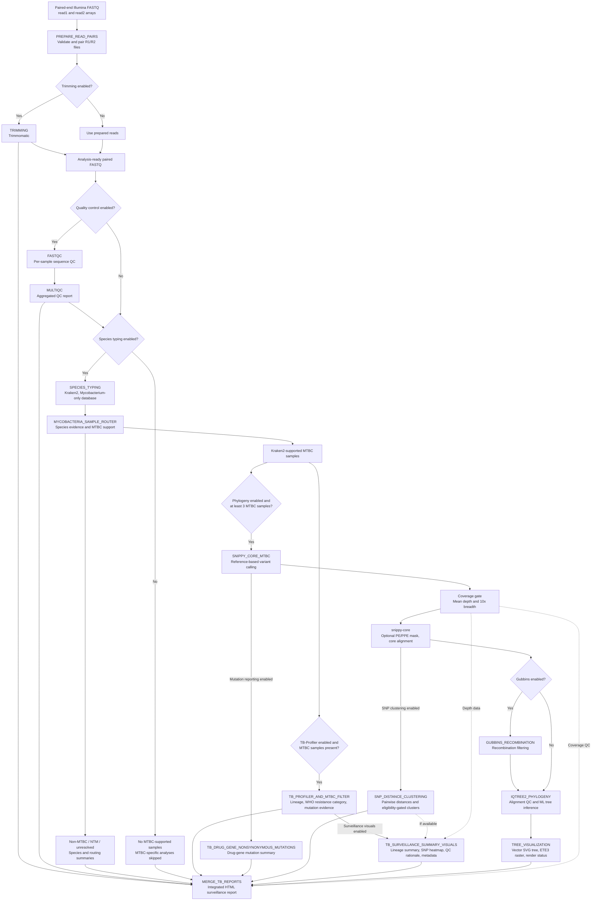

# rMAP-TB: Rapid Mycobacterial Analysis Pipeline for Tuberculosis and Mycobacterial Genomic Surveillance

rMAP-TB is a modular, containerised WDL/Cromwell workflow for public-health genomic analysis of the *Mycobacterium tuberculosis* complex (MTBC) and non-tuberculous mycobacteria (NTM). From paired-end Illumina reads it performs read preprocessing and quality control, Kraken2-based mycobacterial species identification, evidence-based MTBC/NTM sample routing, TB-Profiler drug-resistance and lineage profiling, reference-based variant calling, core-genome SNP distance analysis with threshold-based cluster interpretation, optional recombination filtering, maximum-likelihood phylogenetic reconstruction, and generation of a single, self-contained interactive surveillance report.

**Repository:** https://github.com/gmboowa/rMAP-TB  
**Workflow file:** `rMAP_TB.wdl` (WDL 1.0; current release v22)  
**Licence:** MIT

---

## Table of contents

1. [Overview](#1-overview)
2. [Workflow architecture](#2-workflow-architecture)
   - 2.1 [Visual overview](#21-visual-overview)
   - 2.2 [Execution logic](#22-execution-logic)
   - 2.3 [Species identification and MTBC/NTM routing](#23-species-identification-and-mtbcntm-routing)
   - 2.4 [MTBC-specific analyses](#24-mtbc-specific-analyses)
   - 2.5 [Recombination filtering and phylogenetic inference](#25-recombination-filtering-and-phylogenetic-inference)
   - 2.6 [Tree rendering and surveillance figures](#26-tree-rendering-and-surveillance-figures)
   - 2.7 [Integrated report](#27-integrated-report)
   - 2.8 [Transparency and failure handling](#28-transparency-and-failure-handling)
3. [Repository structure](#3-repository-structure)
4. [Requirements](#4-requirements)
5. [Workflow inputs](#5-workflow-inputs)
   - 5.1 [Required inputs](#51-required-inputs)
   - 5.2 [Optional sample metadata](#52-optional-sample-metadata)
   - 5.3 [Module switches](#53-module-switches)
   - 5.4 [Analytical parameters](#54-analytical-parameters)
   - 5.5 [Resource and rendering parameters](#55-resource-and-rendering-parameters)
6. [Installation and execution](#6-installation-and-execution)
   - 6.1 [System requirements](#61-system-requirements)
   - 6.2 [Obtaining the workflow](#62-obtaining-the-workflow)
   - 6.3 [Workflow engine](#63-workflow-engine)
   - 6.4 [Input configuration](#64-input-configuration)
   - 6.5 [Local execution with Cromwell](#65-local-execution-with-cromwell)
   - 6.6 [Execution on Terra](#66-execution-on-terra)
   - 6.7 [Conditional execution](#67-conditional-execution)
7. [Outputs and interpretation](#7-outputs-and-interpretation)
   - 7.1 [Integrated report](#71-integrated-report)
   - 7.2 [Principal workflow outputs](#72-principal-workflow-outputs)
   - 7.3 [Species identification](#73-species-identification)
   - 7.4 [Drug-resistance prediction](#74-drug-resistance-prediction)
   - 7.5 [SNP distances and cluster interpretation](#75-snp-distances-and-cluster-interpretation)
   - 7.6 [Phylogenetic interpretation](#76-phylogenetic-interpretation)
   - 7.7 [Surveillance metadata](#77-surveillance-metadata)
8. [Example datasets and reports](#8-example-datasets-and-reports)
9. [Software components and versions](#9-software-components-and-versions)
10. [Intended use and limitations](#10-intended-use-and-limitations)
11. [Citation and licence](#11-citation-and-licence)
12. [Contributing and support](#12-contributing-and-support)

---

## 1. Overview

Genomic surveillance of tuberculosis requires three questions to be answered for every sequenced sample: which mycobacterium it is, which drugs the isolate is predicted to resist, and how closely it is related to other isolates in the same dataset. rMAP-TB answers these questions in a fixed, reproducible order and records the evidence behind each decision.

The workflow separates **species identification and sample routing** from **MTBC-specific analysis**. Kraken2, run against a curated *Mycobacterium*-only database, determines whether a sample is supported as MTBC. Only MTBC-supported samples enter TB-Profiler, reference-based variant calling, SNP-distance analysis and phylogenetic reconstruction; non-MTBC mycobacteria are identified to the most probable species and reported in a dedicated NTM section without being subjected to analyses that are only meaningful for MTBC. Datasets consisting entirely of NTM, entirely of MTBC, or a mixture of both are handled without modification of the workflow.

For MTBC-supported samples, rMAP-TB integrates TB-Profiler lineage and WHO-category resistance calls with mutation-level evidence, Snippy reference-based variant calling with per-sample coverage gating, snippy-core alignment with optional masking of repetitive and PE/PPE regions, pairwise core-SNP distances with explicit eligibility gates (comparable sites, mixed-infection status), optional Gubbins recombination filtering and IQ-TREE2 maximum-likelihood phylogeny. All results, together with the rationale for every inclusion and exclusion, are consolidated into one interactive HTML report.

Execution is containerised (Docker) and orchestrated by Cromwell, so analyses are reproducible across laptops, institutional high-performance computing systems and cloud platforms such as Terra.

---

## 2. Workflow architecture

### 2.1 Visual overview


*Figure 1. Overview of rMAP-TB. Paired-end Illumina reads are trimmed and quality-controlled, classified with Kraken2 and routed as MTBC or non-MTBC. MTBC-supported samples proceed to TB-Profiler, Snippy core-SNP analysis, SNP-distance clustering, optional Gubbins filtering and IQ-TREE2 phylogeny; non-MTBC samples are reported through the NTM speciation branch. All outputs converge in a single integrated surveillance report.*

### 2.2 Execution logic

The workflow is composed of fifteen WDL tasks connected by conditional blocks. A task runs only when its module switch is enabled and its upstream inputs exist, so an unavailable analysis is skipped rather than failing the run.



### 2.3 Species identification and MTBC/NTM routing

`SPECIES_TYPING` classifies trimmed reads with Kraken2 against a curated *Mycobacterium*-only database (76 RefSeq sequences, 50 species, including *M. tuberculosis* H37Rv NC_000962.3 and *M. canettii* NC_015848.1; composition and documented limitations are given in `resources/kraken2_db/README.md`). The database contains no human, non-mycobacterial bacterial, viral or fungal sequences, so reads from other sources are reported as unclassified. Bracken is present in the container image but is not executed.

`MYCOBACTERIA_SAMPLE_ROUTER` combines the top species-level assignment, the read support for the MTBC complex node and the configured confidence thresholds into one routing decision per sample:

1. **Recognised MTBC species.** A confident MTBC top species call is routed to the MTBC branch.
2. **MTBC-complex majority.** A sample whose MTBC complex-node support is at least `mtbc_node_override_percent` (default 50 %) with at least 1,000 supporting reads is routed as MTBC even when a non-MTBC species is the single highest species-level assignment. Genuine NTM showed 0.01–0.39 % complex-node background in the validation panel, so a majority is not background.
3. **Confident non-MTBC species.** A high-confidence non-MTBC *Mycobacterium* call is routed to the NTM branch unless rule 2 applies.
4. **Unresolved species with MTBC evidence.** A species call below `min_species_call_percent` (default 5 %) is treated as unresolved; MTBC support of at least 10 % and 1,000 reads rescues such a sample for the MTBC branch.
5. **Insufficient MTBC evidence.** All other samples are excluded from MTBC-specific analyses and retained in the species and routing reports.

Within the complex, the database discriminates *M. tuberculosis* from *M. canettii* only; a call is evidence of MTBC membership, not of species within the complex. Every decision and its supporting evidence is recorded in `mycobacteria_routing_summary.tsv`, and routing, not downstream task output, drives all sample counts in the final report.

### 2.4 MTBC-specific analyses

**Resistance and lineage.** TB-Profiler is run on every MTBC-routed sample. Each isolate receives a canonical resistance category derived from the drug-level calls rather than from TB-Profiler's umbrella label, so that rifampicin resistance without isoniazid resistance is reported as RR-TB and not as MDR/RR-TB: Sensitive, Hr-TB, RR-TB, MDR-TB, Pre-XDR-TB, XDR-TB, Monoresistance, Polyresistance, Other drug resistance, or Resistance not determined. Mutation-level evidence (drug, gene, variant, confidence grade) is extracted from the TB-Profiler JSON. A **mixed-infection screening flag** is derived from fields TB-Profiler already reports: more than one MTBC main lineage, a lineage fraction below 0.90, or resistance variants at intermediate allele frequency (0.10–0.90). No sensitivity or specificity is claimed for this flag; it is a prompt for review.

**Variant calling and coverage gate.** When phylogenomics is enabled and at least `min_mtbc_samples_for_tree` (default 3) MTBC read pairs are available, `SNIPPY_CORE_MTBC` maps each sample to the reference with Snippy. Before a sample enters the core alignment it must pass a post-mapping coverage gate: mean depth of at least `min_mean_depth` (default 15×) and at least `min_breadth_10x` (default 90 %) of the genome covered at 10×. Samples that fail are recorded in `coverage_qc.tsv` with their measured values and are listed by name in the report.

**Core alignment and masking.** snippy-core builds the core alignment, optionally excluding regions supplied in `snp_mask_bed` (a validated BED of PE/PPE and repetitive regions is provided in `resources/mask/`). Masking is strongly recommended: without it, SNP distances include PE/PPE regions and are not comparable with published MTBC transmission thresholds. The report states whether a mask was applied.

**Drug-gene mutation summary.** `TB_DRUG_GENE_NONSYNONYMOUS_MUTATIONS` extracts non-synonymous variants from the Snippy annotations for a configurable list of resistance-associated genes (`tb_drug_resistance_genes`; default *rpoB, katG, inhA, fabG1, ahpC, embB, pncA, rpsL, rrs, gyrA, gyrB, eis, ethA, ethR, thyA, folC, alr, ddl, gidB, tlyA, rrl, atpE, Rv0678, pepQ*). This complements, and does not replace, the catalogue-based TB-Profiler interpretation.

**SNP distances and clusters.** `SNP_DISTANCE_CLUSTERING` computes pairwise distances from `core.full.aln` (before any Gubbins filtering) and interprets them against `likely_transmission_snp_threshold` (default 5) and `possible_transmission_snp_threshold` (default 12). A pair is eligible for interpretation only when at least `min_comparable_sites` (default 2,205,000, approximately 50 % of H37Rv) alignment columns are unambiguous in both samples, which prevents 0-SNP/0-site pairs being reported as close. Samples carrying the TB-Profiler mixed-infection flag are ineligible by default (`exclude_mixed_infection_from_clustering`), because ambiguous bases in a mixed sample distort pairwise comparisons. An optional per-sample heterozygous-site gate (`max_heterozygous_sites_for_clustering`) is disabled by default and should be calibrated on clonal isolates from the user's own data before use. Eligibility decisions are written to `clustering_eligibility.tsv`.

### 2.5 Recombination filtering and phylogenetic inference

Gubbins is disabled by default (`use_gubbins = false`) because MTBC is highly clonal with negligible homologous recombination. When enabled, its filtered alignment is passed to IQ-TREE2; if Gubbins fails, the unfiltered core alignment is used and the status is recorded.

`IQTREE2_PHYLOGENY` first removes sequences with 50 % or more missing, ambiguous or gap content, writes the included and excluded sample lists with per-sample statistics, and requires at least three non-reference samples to proceed. The tree is inferred with IQ-TREE2 using `iqtree2_model` (default `GTR+G`), 1,000 ultrafast bootstrap replicates and 1,000 SH-aLRT replicates (`-B`, `-alrt`, `-bnni`). The ultrafast bootstrap value is the support statistic shown on the tree.

### 2.6 Tree rendering and surveillance figures

`TREE_VISUALIZATION` parses the IQ-TREE Newick directly (quoted labels, `SH-aLRT/UFBoot` node labels), removes the reference tip, midpoint-roots the tree for display when `midpoint_root_tree` is true, and draws a resolution-independent SVG phylogram with tips coloured by canonical resistance category, lineage labels, support values gated by `max_bootstrap_to_label`, and a scale bar. This renderer depends only on the Python standard library, so a figure is produced from any valid tree. An ETE3 raster image at 300 dpi is produced in addition. A machine-readable `render_status.txt` records the outcome of each renderer, the number of tips drawn and the number of tips successfully joined to TB-Profiler metadata.

`TB_SURVEILLANCE_SUMMARY_VISUALS` produces the lineage distribution, a pairwise SNP-distance heatmap with a log-scaled colour legend (so close pairs remain distinguishable next to distant outliers), per-sample QC-filtering rationale, and a surveillance metadata table that merges routing, lineage, resistance, depth, tree inclusion and any user-supplied metadata.

### 2.7 Integrated report

`MERGE_TB_REPORTS` consolidates every available output into one self-contained HTML file with eleven numbered sections:

1. Sample QC and trimming summary (MultiQC and trimming reports embedded)
2. Species typing (Kraken2)
   - 2b. Non-MTBC mycobacteria species summary
3. TB-Profiler resistance, species and lineage report, with mixed-infection flags and workflow/tree inclusion status
4. Resistance mutation evidence summary
5. Non-synonymous mutation summary
6. Lineage distribution summary
7. Pairwise SNP distance and cluster summary
8. SNP distance heatmap
9. MTBC-only core-SNP phylogenetic tree
10. QC filtering rationale and surveillance metadata
11. Pipeline provenance

The report header summarises the dataset, a status strip reports the outcome of routing, IQ-TREE, tree rendering and heatmap generation, and a resistance-category distribution bar summarises the MTBC isolates. Tables are sortable, searchable and downloadable as CSV; figures are embedded as SVG and can be exported as SVG or 4× PNG. The file has no external dependencies and can be archived or shared as is.

### 2.8 Transparency and failure handling

A surveillance report must distinguish "nothing to report" from "the analysis did not run". rMAP-TB applies this principle throughout:

- Every sample absent from the tree is accounted for by name and reason: non-MTBC routing, coverage-gate failure, IQ-TREE alignment-quality exclusion, or an unavailable record. Counts in the tree notes reconcile with the routing counts.
- Tree rendering is reported from `render_status.txt`, never inferred from the existence of an image file. If a renderer fails, the report shows the error and the renderer log in place of the figure; if the tree is drawn but metadata could not be joined, an explicit warning states how many tips were annotated.
- Input files that could not be parsed are listed at the top of the report, so an empty section is never mistaken for a negative result.
- The QC-filtering rationale table records, for every sample, whether it was selected for the MTBC workflow and whether it was included in IQ-TREE, with the reason for each decision.

---

## 3. Repository structure

```text
rMAP-TB/
├── README.md
├── LICENSE
├── .dockstore.yml
├── .gitignore
├── rMAP_TB.wdl
│
├── examples/
│   ├── inputs.example.json
│   └── inputs.terra.example.json
│
├── scripts/
│   └── build_snp_mask.py
│
├── resources/
│   ├── adapters/
│   │   └── adapters.fa
│   ├── reference/
│   │   └── H37Rv_NC_000962.3.gb
│   ├── mask/
│   │   ├── H37Rv_NC_000962.3_PE_PPE_repetitive.bed
│   │   └── README.md
│   └── kraken2_db/
│       └── README.md
│
├── tests/
│
└── docs/
    ├── index.html
    ├── DEPLOYMENT.md
    ├── reports/
    │   └── README.md
    └── assets/
        ├── workflow/
        │   └── rMAP-TB-workflow.png
        ├── images/
        └── css/
```

| Path | Contents |
|---|---|
| `rMAP_TB.wdl` | The complete workflow: fifteen tasks and the `rMAP_TB` workflow block |
| `examples/` | Input JSON templates for local Cromwell and for Terra |
| `scripts/build_snp_mask.py` | Builds a PE/PPE and repetitive-region BED from the H37Rv GenBank annotation |
| `resources/adapters/` | Adapter sequences for Trimmomatic |
| `resources/reference/` | *M. tuberculosis* H37Rv (NC_000962.3) in GenBank format |
| `resources/mask/` | Validated SNP mask and its documentation |
| `resources/kraken2_db/` | Composition, accessions and limitations of the species-typing database |
| `tests/` | Workflow and script tests |
| `docs/` | Documentation and GitHub Pages site |
| `docs/reports/` | Example integrated reports from the validation panels (Section 8) |
| `docs/assets/workflow/` | Workflow figure |

---

## 4. Requirements

| Requirement | Purpose |
|---|---|
| Java 11 or later | Runs the Cromwell workflow engine |
| Cromwell | Executes the WDL locally, on HPC backends or in the cloud |
| Docker (or a Docker-compatible backend) | Runs the containerised tools; every task declares its image |
| Git | Obtains the repository |
| Paired-end Illumina FASTQ files | Input reads |
| Adapter FASTA | Trimmomatic adapter clipping (`resources/adapters/adapters.fa`) |
| MTBC reference in GenBank format | Snippy variant calling and annotation (`resources/reference/`) |
| SNP mask BED (recommended) | Exclusion of PE/PPE and repetitive regions (`resources/mask/`) |
| Compute resources | Up to 16 CPUs and 64 GB memory for the heaviest tasks by default; adjustable through `max_cpus` and `max_memory_gb` |

The Kraken2 database and the TB-Profiler database are embedded in their container images; no separate database download is required.

---

## 5. Workflow inputs

All inputs are declared in the `rMAP_TB` workflow block and are supplied through a Cromwell JSON file (`rMAP_TB.<parameter>`) or the Terra input form.

### 5.1 Required inputs

| Parameter | Type | Description |
|---|---|---|
| `read1` | `Array[File]+` | Forward (R1) FASTQ files |
| `read2` | `Array[File]+` | Reverse (R2) FASTQ files, in the same order as `read1` |
| `adapters` | `File` | Adapter FASTA for Trimmomatic |
| `mtbc_reference_genbank` | `File` | MTBC reference genome in GenBank format |

`read1` and `read2` must have the same length; files at the same index form one sample. Use *M. tuberculosis* H37Rv (NC_000962.3) as the reference and keep it constant across all samples that will be compared.

### 5.2 Optional sample metadata

`sample_metadata_tsv` accepts a tab-delimited file of sample identifiers and epidemiological fields:

```tsv
sample	country	collection_year	collection_site	sample_source
SAMPLE001	Uganda	2026	Kampala	Sputum
SAMPLE002	Kenya	2026	Nairobi	Sputum
SAMPLE003	Tanzania	2026	Dar es Salaam	Sputum
```

Recognised identifier columns are `sample`, `sample_id`, `isolate`, `isolate_id`, `accession`, `run_accession` and `sra_accession`. Identifiers must match the sample names derived from the FASTQ file names. All other columns are carried into the surveillance metadata table with a `user_` prefix.

### 5.3 Module switches

| Parameter | Default | Effect |
|---|---|---|
| `do_trimming` | `true` | Run Trimmomatic |
| `do_quality_control` | `true` | Run FastQC and MultiQC |
| `do_species_typing` | `true` | Run Kraken2 species typing and MTBC/NTM routing |
| `do_tb_profiler` | `true` | Run TB-Profiler on MTBC-routed samples |
| `do_phylogeny` | `true` | Run Snippy, snippy-core, SNP distances and IQ-TREE2 |
| `use_gubbins` | `false` | Apply Gubbins recombination filtering before IQ-TREE2 |
| `report_nonsynonymous_drug_gene_mutations` | `true` | Summarise non-synonymous variants in resistance-associated genes |
| `report_snp_distance_clusters` | `true` | Compute pairwise SNP distances and cluster interpretations |
| `generate_surveillance_summary_visuals` | `true` | Produce lineage, heatmap, QC-rationale and metadata outputs |
| `midpoint_root_tree` | `true` | Midpoint-root the tree for display (IQ-TREE2 output is unrooted) |

### 5.4 Analytical parameters

| Parameter | Default | Description |
|---|---|---|
| `min_species_call_percent` | `5.0` | Minimum share of classified reads for a confident species-level call |
| `mtbc_node_override_percent` | `50.0` | MTBC complex-node support that overrides a non-MTBC top species call (with ≥ 1,000 reads) |
| `min_mtbc_samples_for_tree` | `3` | Minimum MTBC read pairs before the phylogenomics branch starts |
| `min_mean_depth` | `15` | Minimum mean mapping depth to enter the core alignment |
| `min_breadth_10x` | `0.90` | Minimum fraction of the genome covered at ≥ 10× |
| `min_mapping_quality` | `20` | Minimum quality passed to Snippy |
| `min_read_length` | `50` | Minimum read length retained after trimming |
| `snp_mask_bed` | unset | BED of regions excluded from variant calling; strongly recommended |
| `min_comparable_sites` | `2205000` | Minimum jointly unambiguous alignment columns for a pair to be interpreted |
| `likely_transmission_snp_threshold` | `5` | Upper bound for "genomically close" |
| `possible_transmission_snp_threshold` | `12` | Upper bound for "intermediate SNP distance" |
| `exclude_mixed_infection_from_clustering` | `true` | Make TB-Profiler-flagged mixed infections ineligible for clustering |
| `max_heterozygous_sites_for_clustering` | `0` | Optional per-sample ambiguity gate; `0` disables it |
| `iqtree2_model` | `GTR+G` | Substitution model |
| `iqtree2_bootstraps` | `1000` | Ultrafast bootstrap and SH-aLRT replicates |
| `max_bootstrap_to_label` | `100` | Label internal nodes with support at or below this value (`100` labels every node; `99` hides fully supported nodes to declutter dense trees) |
| `tb_drug_resistance_genes` | see Section 2.4 | Comma-separated genes for the non-synonymous mutation summary |
| `trimmomatic_quality_encoding` | `phred33` | Quality encoding passed to Trimmomatic |
| `snippy_reference_type` | `genbank` | Reference format supplied to Snippy |

IQ-TREE's alignment-quality pre-filter (50 % maximum missing content, minimum of three non-reference samples) is fixed in the workflow.

### 5.5 Resource and rendering parameters

| Parameter | Default | Description |
|---|---|---|
| `max_cpus` | `16` | Upper bound for task CPU requests (tasks use 4, 8 or 16, capped at this value) |
| `max_memory_gb` | `64` | Memory for the high-resource tasks |
| `species_typing_docker` | `gmboowa/mycobacterium-kraken2-bracken:2026.05` | Species-typing image, including the Kraken2 database |
| `tbprofiler_docker` | `staphb/tbprofiler:6.6.6` | TB-Profiler image, including its mutation catalogue |
| `tree_width`, `tree_height` | `2400`, `1600` | Minimum dimensions of the ETE3 raster image (pixels) |
| `tree_image_format` | `png` | Raster format for the ETE3 image (`png`, `svg` or `pdf`) |

---

## 6. Installation and execution

### 6.1 System requirements

rMAP-TB runs wherever Cromwell can execute Docker containers: a workstation, an HPC cluster with a Docker- or Singularity-compatible backend, or a cloud platform. Memory and disk demand are highest in TB-Profiler, Snippy, Gubbins and IQ-TREE2 and scale with the number of samples; the defaults (16 CPUs, 64 GB) are sufficient for panels of several dozen isolates.

### 6.2 Obtaining the workflow

```bash
git clone https://github.com/gmboowa/rMAP-TB.git
cd rMAP-TB
ls -lh rMAP_TB.wdl resources/
```

Record the release tag or commit hash of the checkout; it is required for reproducible reporting.

### 6.3 Workflow engine

Install a Java runtime supported by the chosen Cromwell release and download Cromwell from https://github.com/broadinstitute/cromwell/releases. Confirm the environment:

```bash
java -version
docker --version
docker info
```

Docker must be running and the Cromwell backend must permit Dockerised task execution.

### 6.4 Input configuration

Create `inputs.json` (a template is provided in `examples/inputs.example.json`):

```json
{
  "rMAP_TB.read1": [
    "/absolute/path/SAMPLE001_R1.fastq.gz",
    "/absolute/path/SAMPLE002_R1.fastq.gz",
    "/absolute/path/SAMPLE003_R1.fastq.gz"
  ],
  "rMAP_TB.read2": [
    "/absolute/path/SAMPLE001_R2.fastq.gz",
    "/absolute/path/SAMPLE002_R2.fastq.gz",
    "/absolute/path/SAMPLE003_R2.fastq.gz"
  ],
  "rMAP_TB.adapters": "/absolute/path/rMAP-TB/resources/adapters/adapters.fa",
  "rMAP_TB.mtbc_reference_genbank": "/absolute/path/rMAP-TB/resources/reference/H37Rv_NC_000962.3.gb",
  "rMAP_TB.snp_mask_bed": "/absolute/path/rMAP-TB/resources/mask/H37Rv_NC_000962.3_PE_PPE_repetitive.bed",
  "rMAP_TB.do_trimming": true,
  "rMAP_TB.do_quality_control": true,
  "rMAP_TB.do_species_typing": true,
  "rMAP_TB.do_tb_profiler": true,
  "rMAP_TB.do_phylogeny": true,
  "rMAP_TB.use_gubbins": false,
  "rMAP_TB.report_snp_distance_clusters": true,
  "rMAP_TB.generate_surveillance_summary_visuals": true
}
```

Parameters omitted from the JSON take the defaults listed in Section 5. Three samples is the minimum that allows the phylogenomics branch to run; the branch additionally requires that at least three samples pass the coverage gate and the IQ-TREE alignment-quality filter.

### 6.5 Local execution with Cromwell

```bash
java -jar cromwell.jar run rMAP_TB.wdl --inputs inputs.json
```

Cromwell resolves task dependencies, executes the enabled branches and writes task outputs under `cromwell-executions/` (location depends on backend configuration). The integrated report is the `rMAP_TB.final_merged_html_report` output of the run.

### 6.6 Execution on Terra

The repository includes a `.dockstore.yml` descriptor and `examples/inputs.terra.example.json`. Import the workflow from Dockstore into a Terra workspace, supply the read arrays from a sample set, and point `adapters`, `mtbc_reference_genbank` and `snp_mask_bed` to copies of the `resources/` files in the workspace bucket. Deployment notes are given in `docs/DEPLOYMENT.md`.

### 6.7 Conditional execution

| Situation | Behaviour |
|---|---|
| No MTBC-supported samples | TB-Profiler and all MTBC-specific analyses are skipped; species typing, NTM routing, QC and provenance are reported |
| Fewer than `min_mtbc_samples_for_tree` MTBC pairs | Snippy, SNP distances, Gubbins and IQ-TREE2 are skipped; TB-Profiler results are still reported |
| Fewer than three samples pass the coverage gate or IQ-TREE pre-filter | A fallback tree marker is written and the report shows the exclusion reasons instead of a tree |
| `use_gubbins = false` (default) | IQ-TREE2 runs on the unfiltered core alignment |
| Gubbins fails | The unfiltered alignment is used and the failure is recorded in `gubbins_status` |
| Tree renderer failure | The report shows the renderer error and log; the Newick tree remains downloadable |

---

## 7. Outputs and interpretation

### 7.1 Integrated report

The principal output is `integrated_tb_amr_mtbc_phylogenomics_report.html` (workflow output `rMAP_TB.final_merged_html_report`), accompanied by `rMAP_TB.run_metadata`. Its structure is described in Section 2.7.

### 7.2 Principal workflow outputs

All identifiers are in the `rMAP_TB` namespace. Outputs of conditional tasks are optional and absent when the task did not run.

| Category | Output identifier | Content |
|---|---|---|
| Quality control | `multiqc_report`, `fastqc_summary_tsv`, `trimming_summary` | Read QC and trimming statistics |
| Species typing | `species_typing_tsv`, `species_typing_kraken_reports` | Kraken2 species-level calls and raw reports |
| Routing | `mycobacteria_routing_summary_tsv`, `mycobacteria_routing_status` | Routing decision and evidence per sample |
| NTM | `ntm_species_summary_tsv`, `non_mtbc_species_summary_tsv` | Most probable non-MTBC species and evidence |
| Resistance and lineage | `tbprofiler_summary_tsv`, `tbprofiler_json`, `tbprofiler_mutation_evidence_tsv` | TB-Profiler calls, canonical categories, mixed-infection flag, mutation evidence |
| Variant calling | `core_full_alignment`, `core_snp_alignment`, `snippy_core_vcf`, `snippy_tab_files` | snippy-core alignment, SNP alignment, VCF and per-sample annotations |
| Coverage | `mean_depth_summary_tsv`, `coverage_qc_tsv` | Per-sample depth, 10× breadth and coverage-gate outcome |
| Drug-gene mutations | `nonsynonymous_drug_gene_mutations_tsv` | Non-synonymous variants in resistance-associated genes |
| SNP distances | `pairwise_snp_distance_matrix`, `pairwise_snp_distance_pairs`, `snp_cluster_summary`, `clustering_eligibility`, `alignment_ambiguity` | Distances, pair interpretations, close pairs, eligibility decisions, per-sample ambiguous-site counts |
| Surveillance | `lineage_distribution_tsv`, `lineage_distribution_svg`, `snp_distance_heatmap_svg`, `surveillance_metadata_tsv`, `qc_filtering_rationale_tsv` | Summary tables and figures |
| Phylogeny | `iqtree_newick`, `iqtree_status`, `gubbins_filtered_alignment`, `gubbins_status` | Tree and task status |
| Tree rendering | `tree_svg`, `tree_image`, `tree_render_status`, `tree_render_log` | Vector tree, ETE3 raster, renderer status and log |
| Report | `final_merged_html_report`, `run_metadata` | Integrated report and run stamp |

### 7.3 Species identification

Interpret a species call together with the share of classified reads supporting it, the MTBC complex-node support, the routing decision and the composition of the database. Within MTBC, the database separates only *M. tuberculosis* and *M. canettii*; a sample called *M. tuberculosis* may be any member of the complex. Species calls are computational predictions and require confirmation before clinical or regulatory use.

### 7.4 Drug-resistance prediction

TB-Profiler predicts resistance from catalogued genomic variants. The canonical categories follow the WHO 2021 definitions: Hr-TB (isoniazid-resistant, rifampicin-susceptible), RR-TB (rifampicin-resistant without detected isoniazid resistance), MDR-TB (both), Pre-XDR-TB (MDR/RR-TB plus any fluoroquinolone) and XDR-TB (Pre-XDR-TB plus bedaquiline or linezolid). Genotypic prediction is not phenotypic confirmation; interpret results with the TB-Profiler catalogue version, the confidence grade of each mutation and any available drug-susceptibility testing. Samples carrying the mixed-infection flag deserve particular caution because a resistant subpopulation may be present.

### 7.5 SNP distances and cluster interpretation

| Pairwise distance (default thresholds) | Interpretation shown in the report |
|---|---|
| 0–5 SNPs | Genomically close; review epidemiological linkage |
| 6–12 SNPs | Intermediate SNP distance; review metadata |
| > 12 SNPs | Not clustered by SNP threshold |
| Fewer than `min_comparable_sites` shared sites, or a mixed-infection-flagged sample | Not interpretable; reason given |

Distances are computed on the alignment produced with the user's masking choice; unmasked distances are not comparable with published thresholds. Genomic closeness is a necessary but not sufficient condition for transmission, and the thresholds are configurable. Sampling density, time between isolates, geographic context and lineage structure must inform any transmission inference.

### 7.6 Phylogenetic interpretation

The tree is a maximum-likelihood phylogeny of the MTBC isolates that passed routing, the coverage gate and the IQ-TREE pre-filter. It is midpoint-rooted for display only; IQ-TREE2 infers an unrooted tree. Branch lengths are in substitutions per site of the core alignment, and node labels are ultrafast bootstrap percentages. Tip colours and lineage labels come from the same canonical TB-Profiler table used in Section 3 of the report. Evaluate bootstrap support, masking, alignment quality and sampling representativeness before drawing population-level conclusions.

### 7.7 Surveillance metadata

`surveillance_metadata_tsv` provides one row per sample with routing status, Kraken2 species, TB-Profiler lineage and sub-lineage, canonical resistance category, resistant drugs, mean depth, tree inclusion and any user-supplied fields. It is designed for direct import into line lists and surveillance databases; the QC-filtering rationale table documents why each sample was or was not included at each stage.

---

## 8. Example datasets and reports

Two validation panels built from public sequencing runs accompany the repository and are used in the manuscript. Their integrated reports are provided in `docs/reports/`:

| Report | Panel | Purpose |
|---|---|---|
| `rMAP-TB_v22_run<stamp>_18-sample_in-silico-mixture-panel_integrated_report.html` | Two pure MTBC isolates (ERR038255, ERR13260175) and in-silico mixtures at 5–50 % minor fractions and 40–140× depth, plus a same-lineage control | Demonstrates mixed-infection flagging, exclusion of flagged samples from clustering and the effect of mixtures on lineage barcodes and tree placement |
| `rMAP-TB_v22_run<stamp>_20-sample_NTM-contamination-panel_integrated_report.html` | Twelve public MTBC isolates spanning human- and animal-adapted lineages and *M. canettii*, one MTBC isolate contaminated with *M. avium* reads at 10 % and 50 %, and six NTM species | Demonstrates MTBC/NTM routing, the complex-node majority override, the coverage gate and NTM species reporting |

File names follow `rMAP-TB_<version>_run<UTC stamp>_<n>-sample_<panel>_integrated_report.html`; the run stamp is printed in the report header. `docs/reports/README.md` lists the accessions and the workflow commit for each report.

---

## 9. Software components and versions

| Step | Tool | Container image |
|---|---|---|
| Read pairing | GNU coreutils | `ubuntu:22.04` |
| Trimming | Trimmomatic 0.39 | `quay.io/biocontainers/trimmomatic:0.39--hdfd78af_2` |
| Read QC | FastQC 0.11.9 | `quay.io/biocontainers/fastqc:0.11.9--0` |
| QC aggregation | MultiQC 1.25 | `multiqc/multiqc:v1.25` |
| Species typing | Kraken2 with curated *Mycobacterium* database | `gmboowa/mycobacterium-kraken2-bracken:2026.05` |
| Routing, mutation summaries, SNP distances, surveillance visuals, report | Python 3.11 (standard library) | `python:3.11-slim` |
| Resistance and lineage | TB-Profiler 6.6.6 | `staphb/tbprofiler:6.6.6` |
| Variant calling and core alignment | Snippy 4.6.0, snippy-core, samtools | `staphb/snippy:4.6.0` |
| Recombination filtering | Gubbins 3.4.1 | `staphb/gubbins:3.4.1` |
| Phylogeny | IQ-TREE 2.3.4 | `gmboowa/iqtree2-python:2.3.4` |
| Tree rendering | Python standard library (SVG); ETE3 (raster) | `gmboowa/ete3-render:1.18` |

Image tags are fixed in the workflow so that a given release is fully reproducible; the species-typing and TB-Profiler images can be overridden through `species_typing_docker` and `tbprofiler_docker`.

---

## 10. Intended use and limitations

rMAP-TB is intended for research, genomic epidemiology and public-health surveillance. It is not a clinical diagnostic device. The following limitations apply:

- Species identification is restricted to the taxa in the curated database and cannot discriminate species within the MTBC other than *M. canettii*.
- Resistance prediction depends on the TB-Profiler catalogue version; novel or uncatalogued mechanisms are not detected.
- The mixed-infection flag is a screening heuristic built from TB-Profiler fields; it has not been evaluated against a dedicated mixed-infection method and carries no performance claim.
- SNP-distance thresholds are population- and setting-dependent; the defaults are starting points, not universal rules, and are valid only with appropriate masking.
- Phylogenetic resolution is limited by core-alignment length, sampling and the exclusion of low-coverage or highly ambiguous samples.

---

## 11. Citation and licence

### 11.1 Citation

If rMAP-TB contributes to a publication, report or surveillance programme, please cite the software:

> rMAP-TB: Rapid Mycobacterial Analysis Pipeline for Tuberculosis and Mycobacterial Genomic Surveillance [Computer software]. https://github.com/gmboowa/rMAP-TB

State the release tag or commit, the reference genome, the mask used, and the TB-Profiler and Kraken2 database versions. A journal reference and archived DOI will be added here on publication.

Suggested methods wording:

> Genomic analyses were performed with rMAP-TB (version/commit), a containerised WDL/Cromwell workflow integrating Kraken2 mycobacterial species identification and MTBC/NTM routing, TB-Profiler drug-resistance and lineage profiling, Snippy core-SNP analysis, pairwise SNP-distance clustering and IQ-TREE2 phylogenetic reconstruction.

### 11.2 Licence

rMAP-TB is released under the MIT License (see [LICENSE](LICENSE)). Third-party tools, container images, reference sequences and databases retain their own licences.

---

## 12. Contributing and support

Bug reports, feature requests and contributions are welcome through GitHub issues and pull requests. When reporting a problem, please include the workflow version or commit, the execution environment (Cromwell version, backend, platform), the non-sensitive input parameters, the task-level error message or log, and the expected and observed behaviour. Do not include patient-identifying information, sensitive metadata, credentials or cloud-storage tokens in public issues.
