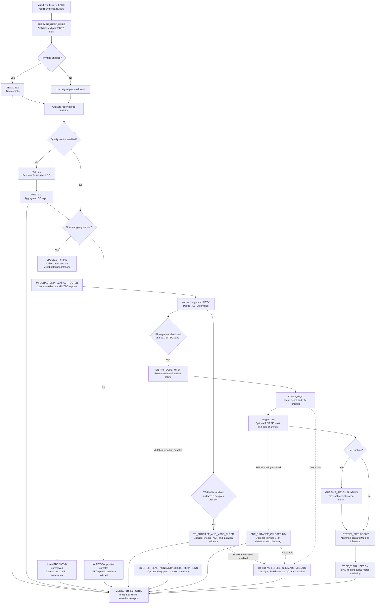

rMAP-TB: Rapid Mycobacterial Analysis Pipeline for Tuberculosis & Mycobacterial Genomic Surveillance
---
rMAP-TB is a modular, reproducible, Dockerized WDL/Cromwell bioinformatics workflow for public-health-oriented genomic analysis of Mycobacterium tuberculosis complex (MTBC) and non-MTBC mycobacteria. It supports paired-end Illumina FASTQ inputs and integrates read preprocessing, sequence quality control, species identification, MTBC/NTM sample routing, tuberculosis drug-resistance prediction, species and lineage profiling, MTBC-only sample filtering, core-SNP phylogenomics, SNP distance analysis, optional phylogenetic reconstruction, and interactive genomic surveillance reporting.

The workflow first performs read trimming, sequence quality control, and Kraken2/Bracken-based Mycobacterium species identification. Species typing is used to route samples before TB-Profiler execution: MTBC-supported samples proceed to TB-Profiler for drug-resistance prediction, species identification, and lineage profiling, while non-MTBC mycobacteria are summarized separately through a dedicated nontuberculous mycobacteria (NTM) speciation branch. This approach enables the workflow to report the most probable NTM species without subjecting non-MTBC samples to MTBC-specific resistance and lineage analyses.

For MTBC-supported samples, rMAP-TB integrates reference-based read alignment, variant calling, core-genome SNP identification, and SNP distance analysis to support genomic relatedness assessments and molecular epidemiological investigations. Optional phylogenomic reconstruction enables the characterization of evolutionary relationships among isolates, supporting investigations of potential transmission clusters and population structure.

The pipeline combines antimicrobial resistance prediction, taxonomic identification, phylogenomic analysis, and genomic surveillance reporting within a standardized, portable, and reproducible computational framework. Containerized execution through Docker and workflow orchestration using WDL/Cromwell facilitate consistent analyses across compatible local, institutional, and cloud computing environments.

## Visual Overview of the rMAP-TB Workflow

The rMAP-TB pipeline integrates sequencing quality control, Mycobacterium species identification, MTBC/NTM sample routing, tuberculosis drug-resistance prediction, core-SNP analysis, phylogenomic reconstruction, and genomic surveillance reporting within a reproducible WDL/Cromwell framework.

*Figure 1. Overview of the rMAP-TB workflow, showing paired-end Illumina sequencing inputs, read preprocessing and quality control, Kraken2/Bracken-based species identification, MTBC/NTM sample routing, TB-Profiler-based drug-resistance and lineage profiling for MTBC-supported samples, independent NTM species reporting, core-SNP analysis, SNP distance estimation, optional phylogenomic reconstruction, and integrated interactive genomic surveillance reporting.*

## Detailed workflow logic & sample routing

rMAP-TB v19 implements a conditional, Dockerized WDL/Cromwell workflow. It separates species identification and sample routing from MTBC-specific resistance analysis and phylogenomics. Non-MTBC samples remain represented in the final surveillance report without undergoing inappropriate MTBC-specific analyses.

### Workflow execution and sample routing

### Species identification and routing decisions

The `SPECIES_TYPING` task uses Kraken2 and a custom *Mycobacterium*-focused reference database. Although the container name includes Bracken, **Bracken is not executed in v19**.

The routing algorithm considers the top species-level assignment, MTBC-complex read support, and confidence evidence:

1. **Recognized MTBC species:** Samples with a recognized MTBC top species call are retained for MTBC-specific analyses.
2. **MTBC-complex majority:** Samples with at least 50% MTBC-complex support and at least 1,000 supporting reads are retained, even if another species is the highest individual species-level assignment.
3. **Clear non-MTBC species:** A high-confidence non-MTBC *Mycobacterium* call is excluded from MTBC-specific analyses unless the MTBC-majority override applies.
4. **Unresolved species with MTBC evidence:** MTBC support of at least 10% and 1,000 reads can rescue an otherwise unresolved species-level call for MTBC routing.
5. **No sufficient MTBC evidence:** Samples are excluded from MTBC-specific downstream analysis and retained in the routing and species reports.

The default minimum species-call percentage is 5%. Routing decisions and supporting evidence are recorded in `mycobacteria_routing_summary.tsv`.

### MTBC-specific analysis

For Kraken2-supported MTBC samples, **TB-Profiler** performs tuberculosis drug-resistance prediction, lineage identification, species profiling, and mutation-evidence reporting.

When phylogenomic analysis is enabled and at least three MTBC read pairs are available, `SNIPPY_CORE_MTBC` performs reference-based variant calling. Coverage filtering is then applied before samples enter the core alignment.

Default coverage requirements:

- Minimum mean sequencing depth: **15×**
- Minimum breadth covered at 10×: **90%**
- Optional repetitive/PE-PPE-region masking using `snp_mask_bed`

The subsequent analyses branch from the Snippy results:

- **Drug-gene mutation analysis:** Optional extraction of nonsynonymous variants in selected tuberculosis drug-resistance-associated genes.
- **Pairwise SNP distances:** Comparison using the Snippy `core.full.aln` alignment before any optional Gubbins filtering.
- **SNP clustering:** Interpretation using default thresholds of 5 SNPs for likely genomic linkage and 12 SNPs for possible genomic linkage, subject to quality and eligibility gates.
- **Phylogenetic reconstruction:** Optional Gubbins recombination filtering followed by IQ-TREE2 maximum-likelihood inference.

The default minimum number of comparable alignment sites for clustering is 2,205,000. Samples flagged by TB-Profiler as possible mixed infections are excluded from transmission clustering by default.

**Important:** SNP-distance thresholds indicate genomic relatedness; they do not independently establish direct transmission.

### Optional recombination filtering and phylogeny

Gubbins is **disabled by default** (`use_gubbins = false`), reflecting the highly clonal nature of MTBC. When enabled, its filtered alignment is passed to IQ-TREE2. If Gubbins fails internally, the task passes the original core alignment forward.

IQ-TREE2 uses the default `GTR+G` model and 1,000 bootstrap replicates. Before inference, sequences with at least 50% missing or ambiguous alignment content are excluded from the tree only. At least three non-reference samples must remain for phylogenetic inference.

The `TREE_VISUALIZATION` task generates an SVG phylogeny directly from the Newick tree and attempts ETE3-based raster rendering, with rendering-status information retained for reporting.

### Integrated genomic surveillance outputs

`TB_SURVEILLANCE_SUMMARY_VISUALS` generates surveillance information when TB-Profiler results are available, including lineage distributions, SNP-distance heatmaps where available, coverage summaries, QC-filtering rationale, and associated metadata.

Finally, `MERGE_TB_REPORTS` consolidates available outputs into an integrated, interactive HTML report, including:

- Sequence QC and trimming summaries
- Species identification and MTBC/NTM routing
- TB-Profiler resistance, lineage, and mutation evidence
- Nonsynonymous drug-gene mutations, when enabled
- Pairwise SNP distances and cluster interpretations
- Lineage distribution and SNP-distance visualizations
- Core-SNP phylogenetic trees, where generated
- Sample inclusion/exclusion rationale and pipeline provenance

**NTM-only datasets:** If no MTBC-supported samples are detected, TB-Profiler and MTBC-specific phylogenomic tasks are skipped. The final report retains the available species-identification, NTM-routing, QC, and provenance information.

All optional analyses depend on their WDL execution conditions and available upstream outputs.
